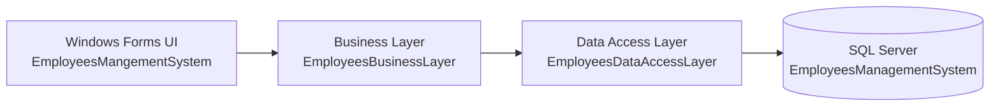

<div align="center">

# Employees Management System

### A desktop employee-management application built with C# and Windows Forms

Manage employee records, track daily attendance, and review payroll and hiring statistics in a SQL Server-backed three-layer application.

[](https://github.com/mohamed-shaaban-cs/Employees-Management-System)
[](https://dotnet.microsoft.com/)
[](https://www.microsoft.com/sql-server)
[](./LICENSE)

</div>

## Screenshots

> Real screenshots from the application, stored in the repository.

<table>
<tr>
<td align="center" width="50%">

<br>
<b>Employee Directory</b>
</td>
<td align="center" width="50%">

<br>
<b>Search and Employee Records</b>
</td>
</tr>
<tr>
<td align="center" width="50%">

<br>
<b>Add Employee</b>
</td>
<td align="center" width="50%">

<br>
<b>Edit Employee</b>
</td>
</tr>
<tr>
<td align="center" width="50%">

<br>
<b>Attendance Management</b>
</td>
<td align="center" width="50%">

<br>
<b>Employee Statistics</b>
</td>
</tr>
</table>

## Table of Contents

- [Overview](#overview)
- [Features](#features)
- [Tech Stack](#tech-stack)
- [Architecture](#architecture)
- [Project Structure](#project-structure)
- [Getting Started](#getting-started)
- [Database Setup](#database-setup)
- [Configuration](#configuration)
- [Running the Application](#running-the-application)
- [Core Workflows](#core-workflows)
- [Known Limitations](#known-limitations)
- [Contributing](#contributing)
- [License](#license)

## Overview

**Employees Management System** is a Windows desktop application for organizing employee records and attendance. It provides a practical interface for:

- Viewing and searching employees
- Adding and editing employee information
- Deleting employees when database-dependent records permit it
- Recording and updating daily attendance
- Reviewing salary and hiring statistics
- Identifying recent hires

The repository uses a three-layer C# design:

```text
Presentation  →  EmployeesMangementSystem
Business      →  EmployeesBusinessLayer
Data Access   →  EmployeesDataAccessLayer
Database      →  SQL Server
```

This project is useful for learning Windows Forms development, ADO.NET database access, and the separation of presentation, business, and persistence concerns.

## Features

### Employee Directory

- Displays employees in a searchable `DataGridView`
- Searches by employee ID or first/last name
- Adds, edits, and deletes employee records
- Reports the number of employees matching the current search

### Employee Data

Each employee record contains:

- Employee ID
- First name
- Last name
- Phone number
- Salary
- Hire date

### Attendance Tracking

- Select a date with a date picker
- Load all employees eligible for that date
- Assign **Present**, **Absent**, **Late**, or **Leave** status
- Update existing attendance records
- Insert new attendance records
- View employee, present, absent, late, and leave totals
- Calculate and display attendance rate

### Statistics and Reports

- Total employee count
- Maximum salary
- Minimum salary
- Average salary
- Total payroll
- Employee count hired during the current year
- Three most recent hires

## Tech Stack

| Category | Technology |
|---|---|
| Language | C# |
| User Interface | Windows Forms |
| Runtime | .NET Framework 4.8.1 |
| IDE | Visual Studio 2022 |
| Database | Microsoft SQL Server |
| Data Access | ADO.NET and `System.Data.SqlClient` |
| UI Components | `DataGridView`, `Chart`, `DataGridViewComboBoxColumn` |
| License | MIT |

## Architecture



### Presentation Layer

Located in `EmployeesMangementSystem`, this project contains:

- `Program.cs`, the application entry point
- `EmployeesMangementSystemForm.cs`, the main application form
- `frmAddOrEditEmployee.cs`, the add/edit employee dialog
- `UIOptimizer.cs`, UI rendering helpers
- Windows Forms resources and controls

The presentation layer calls public classes from `EmployeesBusinessLayer`.

### Business Layer

Located in `EmployeesBusinessLayer`, this project contains:

- `clsEmployee`
- `clsAttendance`
- `clsAttendanceStatus`
- `clsAttendanceReports`
- `clsEmployeesStatistics`

These classes manage add/update save modes and call the data-access classes.

### Data Access Layer

Located in `EmployeesDataAccessLayer`, this project contains:

- Employee CRUD operations
- Attendance CRUD operations
- Attendance-status lookups
- Attendance-report queries
- Employee statistics queries
- SQL Server connection settings

## Project Structure

```text
Employees-Management-System/
├── DataBase/
│   └── EmployeesManagementSystem.bak
├── EmployeesBusinessLayer/
│   ├── clsEmployee.cs
│   ├── clsAttendance.cs
│   ├── clsAttendanceStatus.cs
│   ├── clsAttendanceReports.cs
│   ├── clsEmployeesStatistics.cs
│   └── EmployeesBusinessLayer.csproj
├── EmployeesDataAccessLayer/
│   ├── clsEmployeesData.cs
│   ├── clsAttendanceData.cs
│   ├── clsAttendanceStatusData.cs
│   ├── clsAttendanceReportsDAL.cs
│   ├── clsEmployeesStatisticsData.cs
│   ├── clsDataAccessSettings.cs
│   └── EmployeesDataAccessLayer.csproj
├── EmployeesMangementSystem/
│   ├── Program.cs
│   ├── EmployeesMangementSystemForm.cs
│   ├── frmAddOrEditEmployee.cs
│   ├── UIOptimizer.cs
│   ├── App.config
│   ├── EmployeesMangementSystem.sln
│   └── EmployeesMangementSystem.csproj
├── Screenshots/
│   ├── Employees1.png
│   ├── Employees2.png
│   ├── Add.png
│   ├── Edit.png
│   ├── Attendance.png
│   └── Statistics.png
├── Photos/
├── Sources And References.txt
├── LICENSE
└── ReadMe.md
```

The existing UI directory is named `EmployeesMangementSystem` and should be retained for compatibility with the solution and project files.

## Getting Started

### Prerequisites

- Windows
- Visual Studio 2022
- .NET Framework 4.8.1 Developer Pack
- Microsoft SQL Server
- A SQL Server login or Windows authentication configuration
- `System.Windows.Forms.DataVisualization`

The projects target:

```text
TargetFrameworkVersion: v4.8.1
OutputType: WinExe
Platform: Any CPU
```

## Database Setup

The repository includes a SQL Server backup:

```text
DataBase/EmployeesManagementSystem.bak
```

Restore it using SQL Server Management Studio:

1. Connect to SQL Server.
2. Right-click **Databases**.
3. Select **Restore Database**.
4. Choose **Device** and select `DataBase/EmployeesManagementSystem.bak`.
5. Name the restored database:

   ```text
   EmployeesManagementSystem
   ```

6. Complete the restore.

The application expects the database to provide at least:

- `Employees`
- `Attendance`
- `AttendanceStatus`
- `StatisticsView`

## Configuration

The SQL Server connection string is stored in:

```text
EmployeesDataAccessLayer/clsDataAccessSettings.cs
```

The current development value is:

```csharp
static public string ConnectionString =
    "Server = .; Database = EmployeesManagementSystem; User Id = sa ; Password = 123456;";
```

Replace it with a connection string appropriate for your SQL Server instance.

### SQL Server Authentication

```csharp
static public string ConnectionString =
    "Server=localhost;Database=EmployeesManagementSystem;User Id=sa;Password=YOUR_PASSWORD;";
```

### Windows Authentication

```csharp
static public string ConnectionString =
    "Server=localhost;Database=EmployeesManagementSystem;Trusted_Connection=True;";
```

> Do not commit real production passwords or credentials. The existing password is development configuration and should not be used in production.

## Running the Application

1. Clone the repository:

   ```bash
   git clone https://github.com/mohamed-shaaban-cs/Employees-Management-System.git
   cd Employees-Management-System
   ```

2. Restore `EmployeesManagementSystem.bak` in SQL Server.
3. Update the connection string.
4. Open:

   ```text
   EmployeesMangementSystem/EmployeesMangementSystem.sln
   ```

5. Set `EmployeesMangementSystem` as the startup project.
6. Build with `Debug` / `Any CPU`.
7. Run the application.

Build in Debug mode:

```powershell
msbuild EmployeesMangementSystem\EmployeesMangementSystem.sln /t:Build /p:Configuration=Debug
```

Build in Release mode:

```powershell
msbuild EmployeesMangementSystem\EmployeesMangementSystem.sln /t:Build /p:Configuration=Release
```

## Core Workflows

### Add an Employee

1. Open the employee screen.
2. Select **Add**.
3. Enter first name, last name, phone, salary, and hire date.
4. Save the record.

The add/edit form creates a `clsEmployee` and calls `Save()`. The business class then adds the record through `clsEmployeesData`.

### Edit an Employee

1. Select an employee row.
2. Open the context menu and choose **Edit**.
3. Modify the fields.
4. Save the record.

`frmAddOrEditEmployee` loads the employee through `clsEmployee.Find(int)` and updates it in update mode.

### Record Attendance

1. Open the **Attendance** screen.
2. Select a date.
3. Load the attendance list.
4. Assign each employee a status.
5. Select **Save Attendance**.

The application calls:

```csharp
clsAttendance.Find(EmployeeID, CurrentDayDate)
```

It creates a new attendance record when none exists or updates the status of an existing record.

### Delete an Employee

1. Select an employee row.
2. Open the context menu and choose **Delete**.
3. Confirm the deletion.

Database constraints or existing dependent attendance records may prevent deletion.

## Known Limitations

- SQL Server configuration is hard-coded in source.
- The development connection string contains a password that must be replaced before production use.
- The project has no automated test project.
- No CI workflow is included.
- The application is Windows-only because it uses Windows Forms.
- Authentication and role-based authorization are not implemented.
- The project uses a SQL Server backup rather than migration scripts.
- Database exceptions are generally caught and converted into empty or default results instead of detailed UI errors.
- The UI project and some classes use the repository's existing `Mangement` spelling.

## Contributing

Contributions are welcome for:

- Database configuration improvements
- Environment-variable or `App.config` configuration
- Input and null validation
- Unit and integration tests
- Better database error handling
- Migration-based database setup
- Accessibility improvements
- GitHub Actions CI builds

When contributing:

1. Fork the repository.
2. Create a descriptive branch.
3. Make focused changes.
4. Build and test in Visual Studio.
5. Open a pull request.

## License

This project is licensed under the [MIT License](./LICENSE).

Copyright © 2026 Mohamed Shaaban
